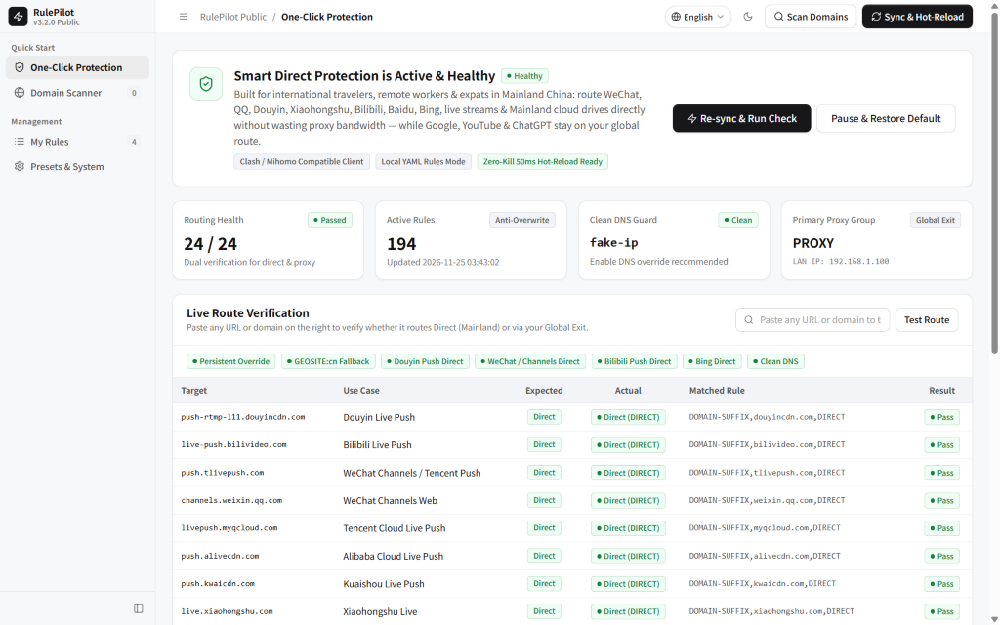
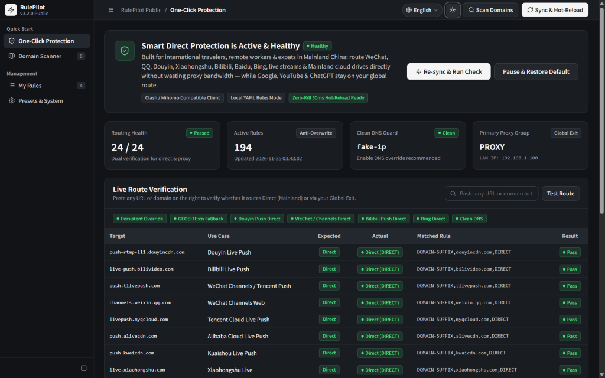
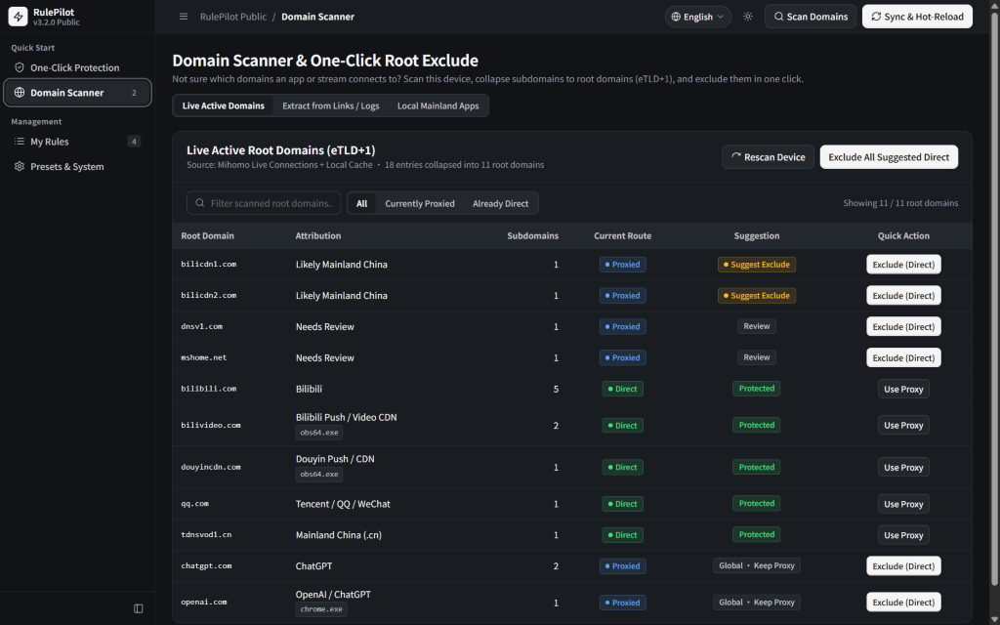
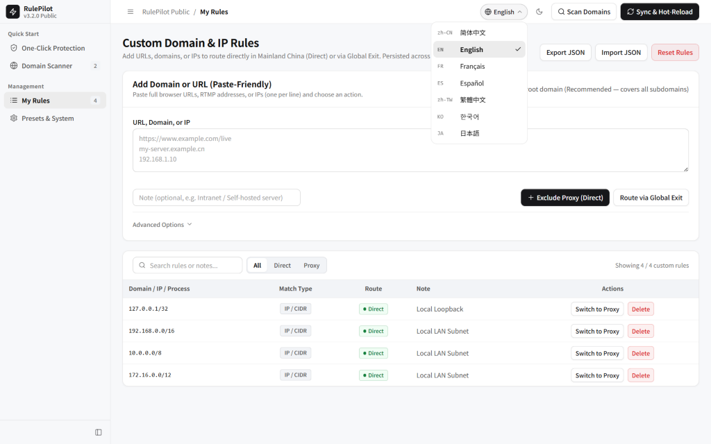

<div align="center">

# ⚡ RulePilot

**A zero-dependency, 7-language routing companion built for international travelers, remote engineers & expats visiting or living in Mainland China.**  
Keep WeChat, QQ, Douyin, Xiaohongshu, Bilibili, Baidu, Bing, Mainland live streams & cloud drives routed directly on local Mainland networks — with zero profile overwrite and zero-kill 50ms hot reload.

[](https://github.com/Blacklake-Go/RulePilot)
[](LICENSE)
[-3776ab?style=flat-square&logo=python&logoColor=white)](rule_pilot.py)
[](#-7-language-one-ui-v20-console)
[](#%EF%B8%8F-legal-disclaimer-compliance--terms-of-use)

**English** | [**简体中文**](README_zh_CN.md) | [**Legal Disclaimer**](#%EF%B8%8F-legal-disclaimer-compliance--terms-of-use)

<br/>

<picture>
  <source media="(prefers-color-scheme: dark)" srcset="docs/screenshots/home-dark.png">
  <source media="(prefers-color-scheme: light)" srcset="docs/screenshots/home-light.png">
  
</picture>

*Auto-adapts to GitHub Light / Dark themes — pure Python standard library, zero external CDN fonts, zero telemetry, opens locally in 1 second.*

</div>

---

## 🌏 Built for Visiting & Living in Mainland China

If you are traveling, working remotely, or creating content in **Mainland China** while managing desktop YAML/SQLite network profiles (compatible with **Clash Verge Rev**, **Mihomo Party**, **FlClash**, **Stash**, etc.), you've likely hit these pain points:

1. **Mainland apps route through remote nodes & waste bandwidth** — Essential daily tools you rely on in Mainland China (WeChat, Alipay, Douyin, Bilibili, Xiaohongshu, Baidu Maps/Search, Bing, cloud drives, and hotel/office LANs) suffer huge latency or eat up your global traffic quota when DNS leaks or unlisted CDN hosts aren't matched `DIRECT`.
2. **Profile refreshes wipe custom direct rules** — Whenever remote or local profiles sync or reload, manually added `DIRECT` entries for Mainland websites and local servers silently vanish.
3. **Hand-editing YAML / JS scripts is intimidating** — International visitors shouldn't need to memorize `DOMAIN-SUFFIX`, `GEOSITE`, `fake-ip-filter`, or SQLite override internals just to stay connected smoothly in China.

**RulePilot solves all three with one click** inside an Apple-grade **One UI v2.0** localhost console (`127.0.0.1`).

---

## ✨ Key Features

| Capability | What It Does for You |
| :--- | :--- |
| 🛡️ **Zero-Kill 50ms Hot-Reload + Anti-Overwrite** | Never force-kills your running desktop client. Syncs local routing rules via the loopback controller API (`PUT /configs?force=true`) in ~50ms while preserving a persistent JS Override or pinned YAML block across profile updates. |
| 🔍 **Smart Domain Scanner & Live Core Connections** | Inspects loopback controller `/connections` (showing originating process names), **Windows/macOS local DNS cache**, **pasted URLs/RTMP logs**, and **common Mainland China desktop apps**, collapsing messy subdomains (`push-rtmp-l11.douyincdn.com`) into clean `eTLD+1` roots. |
| 🧬 **Mainland DNS Guard & 24-Point Self-Check** | Formats clean Mainland DNS rules for China streaming & service CDNs and runs 24 built-in routing simulations plus custom URLs via an interactive **Live Route Tester**. |
| 🌍 **7-Language One UI v2.0 + Motion** | Top-right language switcher pill (`zh-CN`, `en`, `fr`, `es`, `zh-TW`, `ko`, `ja`) with full keyboard navigation, micro-interaction transitions, and a circular **View Transition** theme toggle. |
| 🔒 **100% Offline & Local · Zero Dependencies** | Built exclusively on the Python 3 standard library (`rule_pilot.py` + `ui.html`). No `pip install`, zero external telemetry, and automatic timestamped backups before every local write. |

---

## 📸 Visual Showcase

<table>
  <tr>
    <td width="50%" align="center">
      <b>One-Click Protection (Light Mode)</b><br/>
      
    </td>
    <td width="50%" align="center">
      <b>One-Click Protection (Dark Mode)</b><br/>
      
    </td>
  </tr>
  <tr>
    <td width="50%" align="center">
      <b>Live Domain Scanner &amp; eTLD+1 Grouping</b><br/>
      
    </td>
    <td width="50%" align="center">
      <b>Top-Right 7-Language Switcher &amp; Custom Rules</b><br/>
      
    </td>
  </tr>
</table>

---

## 🌍 7-Language One UI v2.0 Console

Switch interface languages anytime via the **top-right pill button** — persisted in `localStorage` and synchronized with `<html lang>`:

| Code | Native Label | Coverage |
| :--- | :--- | :--- |
| `zh-CN` | **简体中文** | Full UI, presets, scanner diagnostics & API feedback |
| `en` | **English** | Full UI, presets, scanner diagnostics & API feedback |
| `fr` | **Français** | Full UI, presets, scanner diagnostics & API feedback |
| `es` | **Español** | Full UI, presets, scanner diagnostics & API feedback |
| `zh-TW` | **繁體中文** | Full UI, presets, scanner diagnostics & API feedback |
| `ko` | **한국어** | Full UI, presets, scanner diagnostics & API feedback |
| `ja` | **日本語** | Full UI, presets, scanner diagnostics & API feedback |

---

## 🚀 Quick Start (English Scripts, Zero Tech Skill Needed)

### Prerequisites
- **Python 3.8+** installed (no third-party packages required).
- An existing local YAML/SQLite configuration folder from a compatible desktop network utility on Windows, macOS, or Linux.

### Step 1 — Download
```bash
git clone https://github.com/Blacklake-Go/RulePilot.git
cd RulePilot
```

### Step 2 — Launch Locally

- **Windows (Double-Click any English Launcher)**:
  - **`start-app-window.bat`** — Opens RulePilot in a standalone, borderless desktop companion window (`--app` mode).
  - **`start-browser.bat`** (or **`start.bat`**) — Opens RulePilot in your default web browser.
  - **`start-background.vbs`** — Runs quietly in the background (stop anytime via **`stop-background.bat`**).
  - **`create-desktop-shortcut.ps1`** — Creates a desktop `RulePilot.lnk` shortcut pointing to `start-app-window.bat`.
  - PowerShell alternative: `.\start-web.ps1`
- **macOS**:
  - Double-click **`start-macos.command`**, or run `./start-web.sh`.
- **Linux / Terminal**:
  ```bash
  python3 rule_pilot.py ui
  ```

### Step 3 — Configure & Verify
1. Click **"Enable One-Click Protection"** (or **"Re-sync & Run Check"**) on the Overview screen.
2. Verify all 24 diagnostic probes show **`24 / 24 Passed`** (Mainland services go `DIRECT`, global tools stay on your global route).
3. Use **Domain Scanner** anytime to inspect live domains, collapse subdomains to `eTLD+1` roots, and adjust routes in one click.

---

## 🖥️ Compatible Config Formats & CLI Reference

RulePilot auto-discovers standard configuration folders across Windows, macOS, and Linux, or targets any explicit folder via `--dir`:

| Configuration Format | Platform | Local Rule Persistence Mode |
| :--- | :--- | :--- |
| **SQLite + JS Script Profile (e.g. FlClash format)** | Windows / macOS / Linux | Local SQLite JS Override Hook + Fallback YAML |
| **YAML Profile (e.g. Clash Verge Rev / Mihomo Party / Nyanpasu)** | Windows / macOS / Linux | Local YAML Top-Priority Marker Block |
| **Custom Directory (`--dir <path>`)** | Cross-platform | Explicit Directory YAML Management |

<details>
<summary><b>Click to expand CLI Commands</b></summary>

```bash
# Launch Web UI (default port 18900, localhost only)
python rule_pilot.py ui --port 18900

# Launch as a compact borderless desktop companion window (--app)
python rule_pilot.py ui --app

# Run 24-point local routing & DNS format diagnostics in terminal
python rule_pilot.py check

# Apply presets & custom rules to detected configuration folder
python rule_pilot.py apply

# Pause RulePilot & restore original pre-modification backup cleanly
python rule_pilot.py disable

# Scan local live DNS cache & group by eTLD+1 root domains
python rule_pilot.py scan

# Export a clean public zip archive (excludes personal custom_rules.json)
python rule_pilot.py export-public
```

</details>

---

## 🔒 Privacy & Local Isolation

- **Localhost Only**: The management server operates strictly on local desktop interfaces.
- **Zero Personal Leaks**: Your custom entries stay in `custom_rules.json`, which is ignored by `.gitignore` and excluded from `export-public` packages (`custom_rules.example.json` serves as the clean template).
- **Non-Destructive Backups**: Pre-edit snapshots are saved locally in `backups/`.

---

## ⚖️ Legal Disclaimer, Compliance & Terms of Use

> [!IMPORTANT]
> **Please read the full terms below (and [`DISCLAIMER.md`](DISCLAIMER.md)) carefully before downloading, installing, modifying, or running RulePilot.** By retaining or using this Software, you agree to be legally bound by every clause below.

1. **Nature of the Software (Purely Local Configuration Utility):**  
   **RulePilot** is strictly an open-source, purely local configuration-file formatter, rule-list organizer, and loopback diagnostic tool written using only the Python standard library. **This Software is NOT a VPN, proxy client, network tunnel, traffic forwarder, encryption relay, or circumvention tool, and contains no proxy kernel or routing daemon.**

2. **No Proxy, Node, Server, or Subscription Services:**  
   This Software does **not** provide, bundle, host, generate, sell, endorse, recommend, or link to any proxy nodes, relay servers, VPN accounts, paid network plans, or subscription URLs.

3. **Jurisdictional Compliance & Prohibited Conduct:**  
   You are strictly prohibited from using this Software for any unlawful purpose or in violation of local, national, or international laws—including circumventing mandatory cybersecurity regulations, unauthorized network scanning/intrusion, infringing third-party intellectual property or privacy rights, or repackaging/reselling this Software as part of an unauthorized commercial proxy or networking service. **Users are solely responsible for verifying compliance with the laws of their jurisdiction and must cease use immediately if such configuration tools are restricted where they reside.**

4. **User Autonomy & Backup Responsibility:**  
   Every configuration edit, preset toggle, scan, and reload is explicitly initiated by the user. Although timestamped backups and restore helpers are included, third-party software behavior varies; users must independently back up critical profiles before applying modifications.

5. **Independent Project & Third-Party Boundaries:**  
   RulePilot is a completely independent open-source project and is **not affiliated with, endorsed by, sponsored by, or connected to** any third-party desktop client project or external codebase. Client names and file structures referenced in documentation are mentioned solely for objective technical format compatibility (nominative fair use) and remain trademarks of their respective owners. We assume no responsibility or liability for third-party software behavior, security, or upstream rule lists.

6. **100% Offline Execution & Zero Telemetry:**  
   Zero telemetry, zero analytics, zero ads, and zero external uploads. All inspections run strictly inside local memory and loopback interfaces (`127.0.0.1`).

7. **Disclaimer of Warranties ("AS IS"):**  
   THIS SOFTWARE IS PROVIDED **"AS IS"** AND **"AS AVAILABLE"**, WITHOUT WARRANTIES OF ANY KIND, EXPRESS OR IMPLIED, INCLUDING MERCHANTABILITY, FITNESS FOR A PARTICULAR PURPOSE, PRESET COMPLETENESS, OR NON-INFRINGEMENT.

8. **Limitation of Liability & Indemnification:**  
   TO THE MAXIMUM EXTENT PERMITTED BY LAW, THE AUTHORS AND CONTRIBUTORS SHALL NOT BE LIABLE FOR ANY DIRECT, INDIRECT, INCIDENTAL, SPECIAL, CONSEQUENTIAL, OR EXEMPLARY DAMAGES (INCLUDING DATA LOSS, PROFILE CORRUPTION, NETWORK DOWNTIME, OR BANDWIDTH LOSS), WITH AGGREGATE LIABILITY CAPPED AT ZERO. YOU AGREE TO INDEMNIFY AND HOLD HARMLESS THE AUTHORS AND CONTRIBUTORS FROM ANY CLAIMS, REGULATORY ACTIONS, OR EXPENSES ARISING FROM YOUR USE OF THIS SOFTWARE OR VIOLATION OF LAW.

9. **License, Severability & Updates:**  
   Released under the **MIT License** ([`LICENSE`](LICENSE)). If any restriction herein is deemed invalid under mandatory law, remaining provisions remain fully enforceable; liability exclusions and lawful-use restrictions take precedence to the fullest extent permitted by law. The maintainers may update these terms at any time without individual notice.

*(Bilingual complete text available in [`DISCLAIMER.md`](DISCLAIMER.md).)*

---

<div align="center">

Open-source under the **MIT License** · [`LICENSE`](LICENSE) · [`DISCLAIMER.md`](DISCLAIMER.md)

</div>
