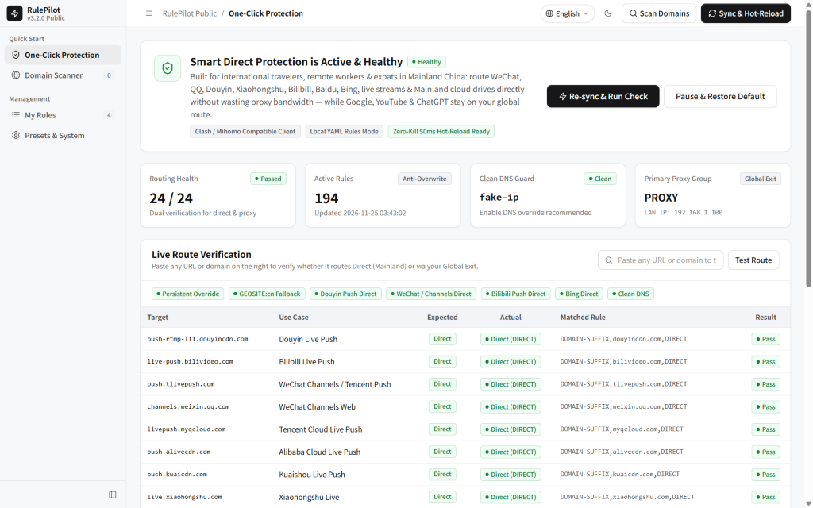
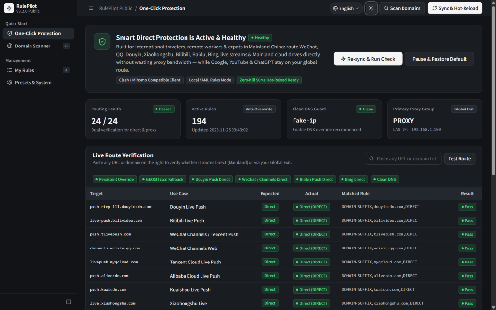
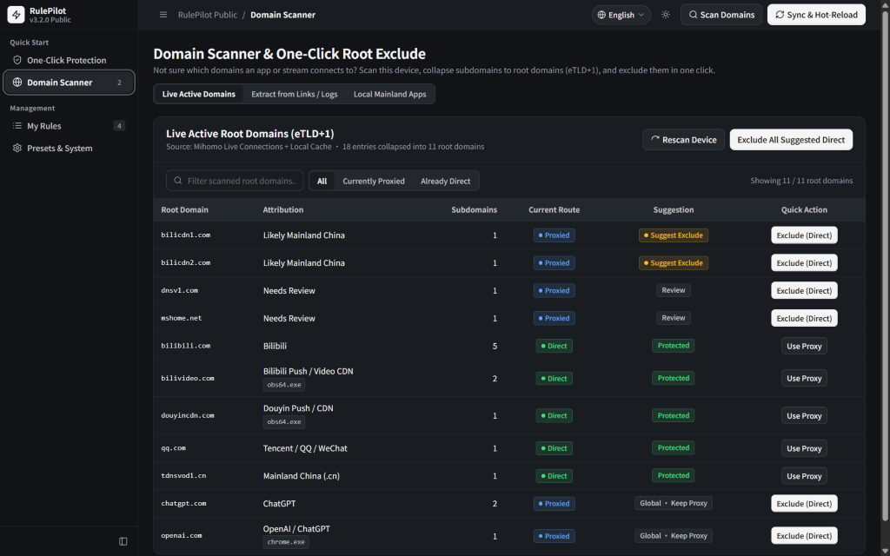
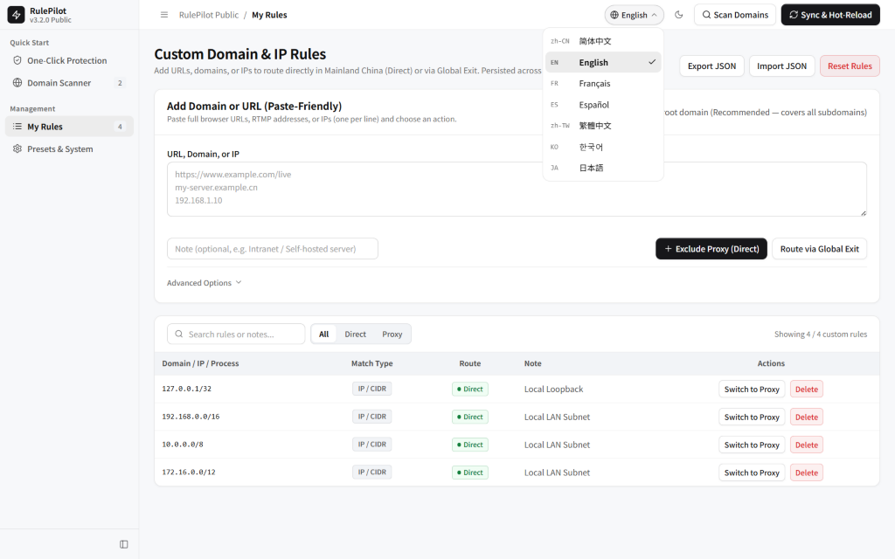

<div align="center">

# ⚡ RulePilot（面向来华旅居用户的本地分流规则与 DNS 配置助手 · 公共版）

**零依赖、支持 7 国语言的纯本地网络分流规则管理与诊断助手，专为前往中国大陆出差、旅行、创作与旅居的国际用户打造。**  
一键让微信、QQ、抖音、小红书、B站、百度、Bing、内地直播推流及网盘直连本土高速网络，免于配置刷新覆盖并支持零杀热重载，同时保持国际常用服务顺畅可用。

[](https://github.com/Blacklake-Go/RulePilot)
[](LICENSE)
[](rule_pilot.py)
[](#-7-种语言与-one-ui-v20-界面体验)
[](#%EF%B8%8F-法律声明合规约束与免责条款)

[**English**](README.md) | **简体中文** | [**法律与免责声明**](#%EF%B8%8F-法律声明合规约束与免责条款)

<br/>

<picture>
  <source media="(prefers-color-scheme: dark)" srcset="docs/screenshots/home-dark.png">
  <source media="(prefers-color-scheme: light)" srcset="docs/screenshots/home-light.png">
  
</picture>

*自动跟随 GitHub 明暗主题切换截图 — 纯 Python 标准库实现，零外部依赖、零联网上报、1 秒打开本机控制台。*

</div>

---

## 🌏 为什么前往中国大陆需要 RulePilot？

国际访客、远程工程师或跨国创作者在中国大陆出行与工作期间，使用各类兼容本地配置文件的桌面端工具（如 **Clash Verge Rev**、**Mihomo Party**、**FlClash**、**Stash** 等）时，经常遇到三大难题：

1. **内地日常应用与直播误走国际路线、白白消耗带宽** —— 在中国大陆日常高频使用的微信、支付宝、抖音、B站、小红书、百度地图/搜索、Bing、网盘及本地酒店/办公局域网，一旦域名后缀或本地 DNS 未匹配 `DIRECT`，就会绕道高延迟国际节点并浪费出口配额。
2. **配置更新直接覆盖自定义规则** —— 每次刷新或重载外部配置源，手工添加的 Mainland `DIRECT` 直连策略就会被清空重置。
3. **手写 YAML / JS 脚本门槛太高** —— 非技术背景的访客不必去学 `DOMAIN-SUFFIX`、`GEOSITE`、`fake-ip-filter` 与 SQLite 覆写机制，也应该能安全顺畅地使用内地网络生态。

**RulePilot 将这一切简化为“一键配置 + 可视化域名扫描”**，并严格遵循 **One UI v2.0** 界面与交互规范，提供 7 种母语界面零门槛上手。

---

## ✨ 核心亮点

| 功能模块 | 为您解决的实际问题 |
| :--- | :--- |
| 🛡️ **零杀 50ms 热重载 + 防覆盖双引擎** | **绝不强杀正在运行的本地客户端进程！** 规则变动时优先通过回环接口 `PUT /configs?force=true` 毫秒级热更新生效，同时持续写入持久化 JS 覆写钩子或 YAML 置顶标识块，配置刷新也不丢失。 |
| 🔍 **实时连接抓域与 eTLD+1 智能归并** | 支持直连本机回环 `/connections` 接口（精确识别发起连接的本地进程名）、**Windows / macOS 本机 DNS 缓存**、**链接日志粘贴提取**与**常见内地桌面软件识别**，自动折叠冗长子域名为一级根域名一键配置直连排除。 |
| 🧬 **内地 DNS 规范与 24 项本地模拟自检** | 一键整理中国大陆常用网站与直播 CDN 的内地本土 DNS 解析配置，并在本地运行 24 项路由匹配模拟器与**实时 URL 路由测速框**，直观验证内地直连与国际路由命中情况。 |
| 🌍 **7 国语言 + 右上角胶囊切换 + One UI 动效** | 内置简体中文、English、Français、Español、繁體中文、한국어、日本語；右上角支持方向键无障碍导航与平滑缩放动画，主题切换具备原生圆形扩散 **View Transition** 动效。 |
| 🔒 **纯本地零依赖 · 自动时间戳备份** | 100% Python 3 标准库实现（`rule_pilot.py` + `ui.html`），无需安装第三方依赖，零外部网络遥测；修改任何本地配置前自动生成时间戳备份，支持随时一键还原。 |

---

## 📸 实机界面展示

<table>
  <tr>
    <td width="50%" align="center">
      <b>一键规则保护中心（浅色模式）</b><br/>
      
    </td>
    <td width="50%" align="center">
      <b>一键规则保护中心（深色模式）</b><br/>
      
    </td>
  </tr>
  <tr>
    <td width="50%" align="center">
      <b>本机域名扫描与 eTLD+1 智能分组</b><br/>
      
    </td>
    <td width="50%" align="center">
      <b>右上角 7 语言切换菜单与自定义规则管理</b><br/>
      
    </td>
  </tr>
</table>

---

## 🌍 7 种语言与 One UI v2.0 界面体验

点击右上角语言胶囊按钮即可在以下 **7 种语言**间实时切换，全部界面元素、预设说明、扫描结果及操作提示均已针对国际来华访客视角深度本地化：

| 语言代码 | 界面显示名称 | 完整适配范围 |
| :--- | :--- | :--- |
| `zh-CN` | **简体中文** | 全界面 UI、规则预设、域名扫描分析、接口回执 |
| `en` | **English** | 全界面 UI、规则预设、域名扫描分析、接口回执 |
| `fr` | **Français** | 全界面 UI、规则预设、域名扫描分析、接口回执 |
| `es` | **Español** | 全界面 UI、规则预设、域名扫描分析、接口回执 |
| `zh-TW` | **繁體中文** | 全界面 UI、规则预设、域名扫描分析、接口回执 |
| `ko` | **한국어** | 全界面 UI、规则预设、域名扫描分析、接口回执 |
| `ja` | **日本語** | 全界面 UI、规则预设、域名扫描分析、接口回执 |

---

## 🚀 三步快速上手（全英文标准脚本名 · 零技术门槛）

### 准备条件
- 本机已安装 **Python 3.8+**（无需安装任何额外第三方包）。
- 本机已存在您自行准备的兼容 YAML/SQLite 配置目录。

### 第一步：获取项目
```bash
git clone https://github.com/Blacklake-Go/RulePilot.git
cd RulePilot
```

### 第二步：选择任意启动脚本一键运行

- **Windows 用户**：
  - 双击 **`start-app-window.bat`** —— 以无地址栏独立伴侣桌面微窗打开（推荐，可与客户端并肩共存）；
  - 双击 **`start-browser.bat`**（或 **`start.bat`**）—— 在默认浏览器打开控制台；
  - 双击 **`start-background.vbs`** —— 静默常驻后台运行（随时可通过 **`stop-background.bat`** 一键停止）；
  - 双击或运行 **`create-desktop-shortcut.ps1`** —— 在桌面生成英文快捷方式 `RulePilot.lnk`；
  - PowerShell 启动方式：`.\start-web.ps1`
- **macOS 用户**：
  - 双击 **`start-macos.command`**，或在终端执行 `./start-web.sh`。
- **Linux / 命令行用户**：
  ```bash
  python3 rule_pilot.py ui
  ```

### 第三步：一键整理并验证分流
1. 打开控制台后，点击首页 **"一键开启智能保护"**（或 **"重新同步并体检"**）。
2. 当路由诊断模拟显示 **`24 / 24 全部通过`** 即表示内地日常应用与直连规则已准确生效。
3. 可随时前往 **“扫描域名”** 或 **“我的域名规则”** 粘贴域名或 IP 段，一键配置直连排除或指定出口。

---

## 🖥️ 兼容配置格式与命令行参考

RulePilot 自动识别 Windows / macOS / Linux 下常见配置目录，也可使用 `--dir` 指定任意自定义目录：

| 兼容配置格式 | 支持平台 | 本地持久化写入机制 |
| :--- | :--- | :--- |
| **SQLite + JS 覆写配置格式（如 FlClash 目录结构）** | Windows / macOS / Linux | SQLite 原生 JS 覆写挂钩 + 运行时 YAML 热同步 |
| **标准 YAML 配置格式（如 Clash Verge Rev / Mihomo Party / Nyanpasu）** | Windows / macOS / Linux | 本地 YAML 置顶标记区持久化注入 |
| **自定义目录（`--dir <路径>`）** | 跨平台 | 指定目录下配置文件精准管理 |

<details>
<summary><b>点击展开命令行指令（进阶用户）</b></summary>

```bash
# 启动本地 Web 控制台（默认 18900 端口）
python rule_pilot.py ui --port 18900

# 以无地址栏独立伴侣桌面微窗启动（Edge / Chrome App 模式）
python rule_pilot.py ui --app

# 在命令行执行 24 项本地规则匹配与 DNS 体检
python rule_pilot.py check

# 将当前规则写入已检测的配置目录
python rule_pilot.py apply

# 一键暂停 RulePilot 接管并还原至变更前备份
python rule_pilot.py disable

# 扫描本机实时活跃域名并按 eTLD+1 根域名归类
python rule_pilot.py scan

# 打包零个人数据残留的纯净公共分享包
python rule_pilot.py export-public
```

</details>

---

## 🔒 隐私保护与本地隔离设计

- **严格本机回环**：本地诊断与热重载接口全部强制绕过代理，仅对本机回环通信。
- **个人规则严格隔离**：个人添加的域名与 IP 全部存于本地 `custom_rules.json`，已被 `.gitignore` 严格忽略且不会打入 `export-public` 分发包。
- **可逆备份保障**：任何配置变动前均在本地 `backups/` 留存原始副本。

---

## ⚖️ 法律声明、合规约束与免责条款

> [!IMPORTANT]
> **下载、克隆、安装、修改或运行本软件前，请务必仔细阅读以下全部条款及 [`DISCLAIMER.md`](DISCLAIMER.md)。** 一旦继续保留或使用 RulePilot，即视为您已充分阅读并无条件同意受本声明全部条款约束；如所在司法辖区对本地网络配置工具存在限制或禁止性规定，请立即停止使用并删除本软件。

1. **软件性质定位（纯本地配置与诊断工具）：**  
   **RulePilot** 是一款完全基于 Python 标准库构建的**本地配置文件整理、YAML/JSON 规则格式化与回环诊断辅助工具**，仅对用户本机已合法持有的本地文件执行读写校验。**本软件本身不是 VPN、不是代理客户端、不是网络隧道，亦不内置任何流量转发引擎、加密协议或网络节点。**

2. **严正声明不提供任何节点、服务器或订阅服务：**  
   本软件**不内置、不提供、不托管、不生成、不销售、不推荐、不分发**任何网络节点、中继服务器、账号、商业网络服务或外部订阅链接。

3. **严格遵守所在国法规与禁止行为约束：**  
   严禁将本软件用于任何违反所在国家、地区法律法规或企业内控规定的用途，包括但不限于：规避法定网络安全监管、从事未经授权的网络扫描或攻击、流量恶意劫持、侵犯他人知识产权或隐私权，以及将本软件二次打包伪装为商业联网/加速服务对外售卖或非法牟利。**用户须自行确认所在地区的合法性与合规义务。**

4. **用户自治与自行备份义务：**  
   本软件内的目录选择、策略增删、域名扫描与热更新等全部操作均须由用户主动发起并核验。虽然软件提供时间戳自动备份与还原辅助机制，但不同第三方配置环境存在差异，用户仍应在变更前对核心本地配置做好独立备份。

5. **项目完全独立性与第三方商标/责任边界：**  
   本项目为独立自主开源工具，**与任何第三方桌面客户端项目、服务商或外部代码库均无任何隶属、授权、合作、背书或衍生关系**。文档中所列兼容格式或软件名称仅用作客观技术互操作兼容性说明（指示性合理使用），相关名称及商标权均归原合法权利人所有。作者不对任何第三方客户端或外部规则的稳定性与安全性承担任何责任。

6. **100% 本地离线与零遥测隐私保障：**  
   本软件**零遥测、零统计追踪、零广告、零任何远端数据上报**；域名提取与回环检测均在本机内存及 `127.0.0.1` 内部完成，绝不向作者或外部服务器传输任何数据。

7. **全面免除担保（按“现状”提供）：**  
   在适用法律允许的最大范围内，本软件按**“现状（AS IS）”**及**“现有（AS AVAILABLE）”**基础提供，不作任何适销性、特定用途适用性、内置清单时效性或无故障运行之明示或暗示担保。

8. **责任全面豁免与赔偿补偿（Indemnification）：**  
   在适用法律允许的最大范围内，作者、维护者及贡献者不对因使用或无法使用本软件引起的任何直接、间接、附带、特殊、惩罚性或后果性损害（含数据丢失、配置损毁、网络中断或带宽消耗）承担任何赔偿责任，最高累计责任以零元为限。若因用户违法使用、违规配置或侵权引发任何第三方索赔、行政处罚或诉讼，由用户独立承担全部法律与经济责任，并保证作者与贡献者完全免受损害。

9. **开源协议、可分割性与条款修订：**  
   本项目代码按 **MIT 开源协议**（[`LICENSE`](LICENSE)）开源。若本声明部分条款因强行法被认定无效，其余条款仍完全有效；在法律允许范围内，使用限制与免责保护条款优先适用。维护者保留随时更新本声明且不作单独通知的权利。

*(中英文完整法务文本详见 [`DISCLAIMER.md`](DISCLAIMER.md)。)*

---

<div align="center">

基于 **MIT 开源协议**发布 · [`LICENSE`](LICENSE) · [`DISCLAIMER.md`](DISCLAIMER.md)

</div>
